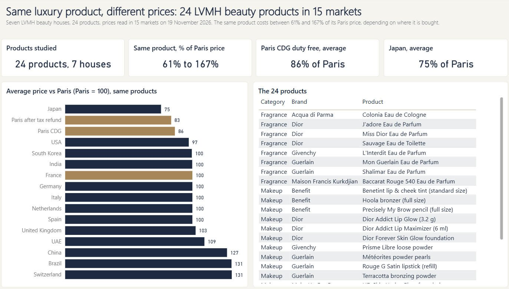
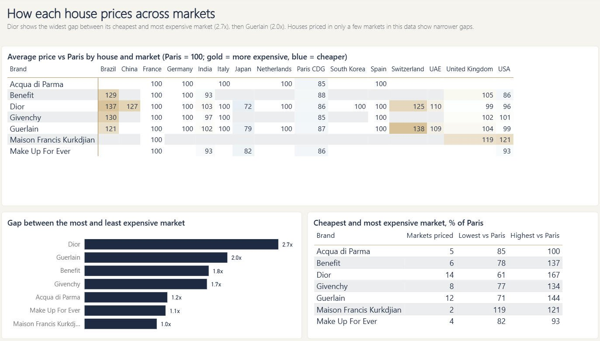
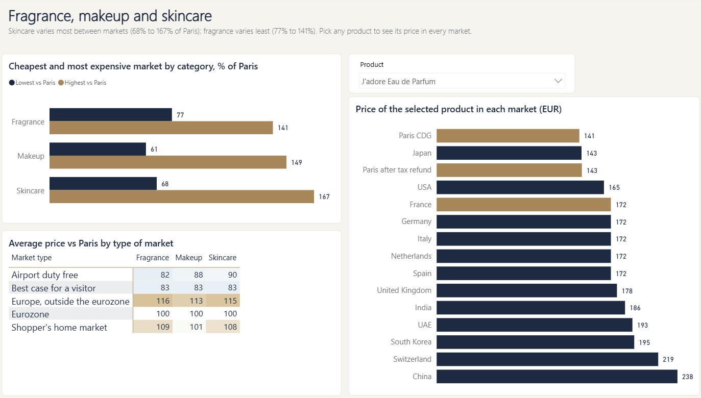
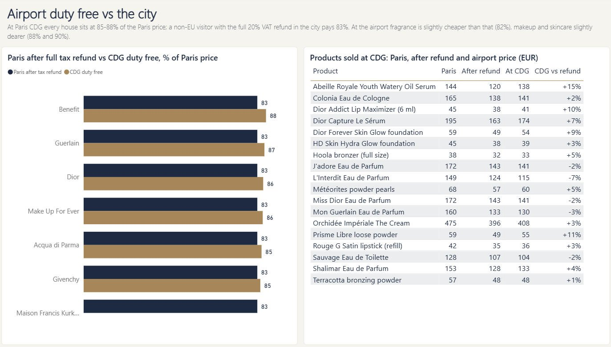
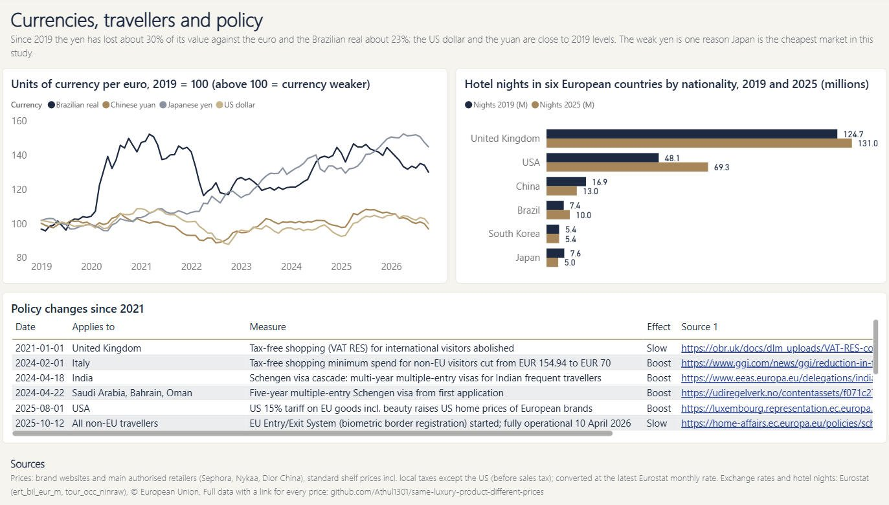

# Same luxury product, different prices: 24 LVMH beauty products in 15 markets

How much does the same Dior or Guerlain product cost in Paris, at the airport, and in the shopper's home country? I collected the prices and built a Power BI report to find out.

## Why I did this

I live in Paris. Friends and family at home regularly ask me to bring back perfume or makeup from here, because they believe it is cheaper. I also compare prices myself whenever I travel. Before my Master's I spent two years in operations at Vedanta, where most of my work came down to cost and process, so I wanted to check the belief with real numbers instead of guessing.

The same question matters to luxury houses. When the same product costs much less in one country than another, travellers buy it where it is cheaper, at the airport, or through someone abroad. That moves sales between markets and between city stores and duty-free. Travel retail and market intelligence teams track these price gaps closely. This project is my small version of that work.

## The question

For a traveller buying luxury beauty, how different is the price of the same product across markets, and is the airport really cheaper than the city?

## What I found

Prices read on 19 November 2026, converted to euros at the Eurostat monthly rate. Paris = 100.

- **The same product costs between 61% and 167% of its Paris price**, depending on where it is bought.
- **Prices are identical across the eurozone.** France, Italy, Spain, Germany and the Netherlands all sit at 100. The gaps appear outside the euro.
- **Dior has the widest gap between its cheapest and most expensive market (2.7x)**, then Guerlain (2.0x).
- **Skincare varies most between markets** (68% to 167% of Paris). Fragrance varies least (77% to 141%).
- **Paris CDG duty-free is at 85-88% of the Paris price for every house.** A non-EU visitor who gets the full 20% VAT refund in a Paris store pays 83%. So the airport is not a bargain compared with the city: fragrance is slightly cheaper there, makeup and skincare slightly dearer.
- **Japan is the cheapest market (75% of Paris on average).** The yen has lost about 30% of its value against the euro since 2019. China, Brazil and Switzerland are about 30% above Paris.

## What I did

1. **Chose 24 products from seven LVMH beauty houses**: Dior, Guerlain, Givenchy, Maison Francis Kurkdjian, Acqua di Parma, Benefit and Make Up For Ever. 8 fragrances, 11 makeup and 5 skincare products, compared at the same size wherever possible.
2. **Collected 262 shelf prices in 15 markets** from the brands' own websites, Paris CDG duty-free (Extime), and the main authorised retailer where a brand has no shop of its own (Sephora, Nykaa in India, Dior's China site). Every price has a link to its source, and the 34 places where a product was not available are recorded as gaps.
3. **Built a policy tracker** of 12 government changes since 2021 that affect travel shopping (visa rules, tax-free rules, tariffs), each with an official source or two news outlets.
4. **Built the Power BI report.** Power Query reads exchange rates and hotel-night data straight from the Eurostat website, and my two tables straight from this GitHub repository. Nothing is pasted in by hand, so the report refreshes with one click.

## The report

| Page | What it shows |
|---|---|
| Overview | Every market against Paris = 100, and the 24 products |
| Houses | A heatmap of each house in each market, and the gap between its cheapest and dearest market |
| Categories and products | Fragrance vs makeup vs skincare; pick any product to see its price in every market |
| Travel retail | Paris CDG duty-free vs the Paris price after a full tax refund, house by house and product by product |
| What moves prices | Exchange rates since 2019, visitor numbers by nationality, and the policy tracker |

## Words used in the report

- **Paris = 100**: the price in a market divided by the Paris price for the same product. 120 means 20% more expensive than Paris, 80 means 20% cheaper.
- **After tax refund**: what a non-EU visitor pays in a Paris store once the 20% VAT is refunded (the price divided by 1.2). It is the best case: refund agencies usually keep a fee.
- **Duty free**: the standard price at Paris CDG airport shops (Extime), without the 10% loyalty discount.

## Limits

- Prices are a snapshot from one day. Promotions and launches change them, so I used the normal shelf price and ignored temporary sales.
- US prices are shown before sales tax, because that is how US websites display them. All other prices include tax.
- Some products are not sold everywhere. Gaps are left empty and explained in the data, not filled in.
- Maison Francis Kurkdjian and Make Up For Ever are priced in only a few markets here, so their gaps look small partly for that reason.
- This is an independent student project. It is not connected to LVMH or any of the brands. Brand names are the property of their owners.

## What is in this repository

- `data/prices.csv`: all 262 prices and 34 documented gaps, each with a source link. `data/policy_tracker.csv`: the 12 policy changes. `data/README.md` explains every column.
- `Same_Luxury_Product_Different_Prices_PowerBI.zip`: the Power BI project. Unzip it and open `Same_Luxury_Product_Different_Prices.pbip` in Power BI Desktop (free). If Power BI asks how to connect, choose **Anonymous**, then **Public**.
- `images/`: the screenshots above.

## Sources and licences

- Exchange rates and hotel nights: Eurostat (`ert_bil_eur_m`, `tour_occ_ninraw`), © European Union, reused with acknowledgement. Eurostat is not responsible for this analysis.
- Prices: the public websites listed in `data/prices.csv`, read on 19 November 2026.

## About me

Thekkinkattil Athul, Master's student in International Management and Business Intelligence at ESCE Paris, with a background in mechanical engineering and two years in operations at a reputed firm .
